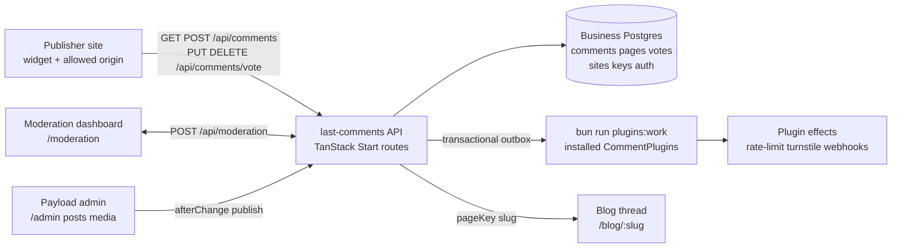
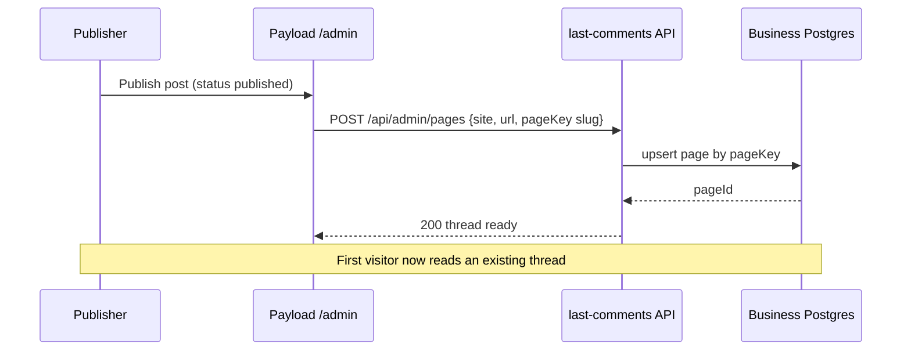

# Introducing last-comments: self-hosted comments for any site

`last-comments` is a self-hosted, Payload-native comment system. Payload CMS stays the content admin at `/admin`, while comments and Better Auth data live in a dedicated Bun + Drizzle business database. One site key powers drop-in threads on any URL — React, Vue, Angular, and plain HTML share one API client and one Tailwind + shadcn theme.

This post is itself seeded from `scripts/seeds/introducing-last-comments.md` (via `bun run db:seed`). Its code blocks are highlighted with [Shiki](https://shiki.style/), and its architecture diagram is rendered with Mermaid. Every blog post also carries its own comment thread below.

## What it is

A Payload v4 + TanStack Start app, extended with a separate comments service:

- **Payload remains the admin** — `users`-only collection, `posts` + `media` for the blog, Postgres with `push: false` + committed migrations. Create the first admin at `/admin`.
- **Comments live elsewhere** — a dedicated business Postgres (`BUSINESS_DATABASE_URL`) holds comments, pages, votes, sites, API keys, and Better Auth tables. It migrates independently (`bun run db:business:migrate`), including per-plugin migrations.
- **One widget, four frameworks** — `@lst97-oss/last-comments-widgets` ships `/react`, `/vue`, `/angular`, and `/vanilla` on one shared client. Hosts embed a site key and a page URL; the server is the trust boundary for every error code.

```tsx
import { Comments } from '@lst97-oss/last-comments-widgets/react'
import '@lst97-oss/last-comments-widgets/react/styles.css'

export function Thread() {
  return (
    <Comments
      baseUrl="https://comments.example.com"
      site="blog"
      pageUrl="https://example.com/blog/introducing-last-comments"
      turnstileSiteKey="0x4AAAAAA..."
    />
  )
}
```

```bash
bun install
cp .env.example .env
bun run db:up
bun run db:migrate
bun run db:business:migrate
bun run dev            # http://localhost:3000
```

## Features

- **Drop-in threads** — one site key, any page URL or stable `pageKey`. Page threads are normally created by their first comment; publishers can pre-register them.
- **Guests + signed-in authors** — guests post with a display name (optional Turnstile token); signed-in users post via a Better Auth session through the first-party deployment or a same-origin proxy.
- **Votes with viewer state** — `GET /api/comments` returns each comment's `score`, the viewer's `viewerVote`, and the author's site role as `authorRole` (`admin` | `moderator` | `null`).
- **Guest edit keys + unlimited author edits** — guests get a one-time `editKey` valid for `COMMENT_ANON_EDIT_WINDOW_MINUTES` (default 10, `0` = unlimited); signed-in authors may edit any time via `PATCH /api/comments/:id`. Delete stays session-only.
- **Moderation dashboard** — `/moderation` reads and writes through `POST /api/moderation`: hide / restore / pin / unpin / delete, page lock, user block, and moderator comment / reply creation. The thread view reuses the published widget for rendering.
- **Publisher API** — site-bound keys with `pages:write` / `pages:read` register threads up front (`POST /api/admin/pages`, idempotent; `pageKey` follows the thread when its URL changes). Instance keys keep `sites:*`.
- **Plugin system** — trusted server-side TypeScript modules, statically imported in `src/server/plugins/config.ts`. Plugins provide `validateComment`, `beforeOperation` (create / edit / delete / vote), and transactional `handleEvent` delivery via `bun run plugins:work`. Rate-limit and Turnstile ship enabled by default.

```bash
# Pre-register a thread before the first comment lands (idempotent)
curl -X POST "$SERVER/api/admin/pages" \
  -H 'content-type: application/json' \
  -H "x-api-key: $PAGES_WRITE_KEY" \
  -d '{
    "site": "blog",
    "url": "https://example.com/blog/introducing-last-comments",
    "pageKey": "introducing-last-comments",
    "title": "Introducing last-comments"
  }'
```

```ts
import { rateLimitPlugin } from '@/server/plugins/config'
import { turnstilePlugin } from '@/server/plugins/turnstile'
import type { CommentPlugin } from '@/server/plugins/comment-plugins'

export const installedCommentPlugins = [turnstilePlugin, rateLimitPlugin] satisfies readonly CommentPlugin[]
```

## Workflow

1. A publisher creates a site in `/moderation`, configures its allowed origins, and mints a site key (optionally a `pages:write` key for pre-registration).
2. The host embeds `<Comments site pageUrl />`. The first comment creates the page thread — or the publisher claims it up front via `POST /api/admin/pages` with a stable `pageKey` (the blog uses the post `slug`).
3. Readers comment as guests (display name + Turnstile where required) or signed in with Google. Votes ride `PUT /api/comments/vote`; guests keep an `editKey` for their window.
4. Moderators work in `/moderation`: hide / restore / pin / delete, lock pages, block users, and post as moderators. Every write emits a transactional outbox event; `bun run plugins:work` delivers it to installed plugins with retries.
5. Publishing a blog post fires `posts.afterChange`, which registers `/blog/<slug>` through the publisher key so the first visitor never owns thread creation.





## Goal

Stay minimal and portable: every file must justify itself for boot (`/`, `/admin`, `/api/*`). No chat, no RAG, no storage abstractions — those belong in a downstream product. What ships is the smallest kernel that makes self-hosted comments boring:

- Framework-agnostic embeds with one API contract and one theme.
- Payload-native publishing with stable `pageKey` threads.
- A moderation story that works without leaving the repo.
- A plugin seam for validation, rate limits, verification, and events — without runtime code discovery.

## Non-goals

- Multi-tenant SaaS billing, analytics dashboards, or hosted moderation queues.
- Rich-text comments — bodies are Markdown (GFM, raw HTML stripped, `http(s)` / `mailto` links only), capped at 10,000 characters.
- Cross-site sessions — voting and moderation require a first-party session or a same-origin proxy; the API sends no `Access-Control-Allow-Credentials`.

## Try it

Publish this file locally, then open its thread:

```bash
bun run db:seed          # upsert scripts/seeds/introducing-last-comments.md
bun run dev              # http://localhost:3000/blog/introducing-last-comments
```

Set `BLOG_SITE_KEY` to the site key created in `/moderation` to light up the thread below. Without it the page renders a configuration notice instead of the widget — the post itself still renders, Mermaid and Shiki included.
